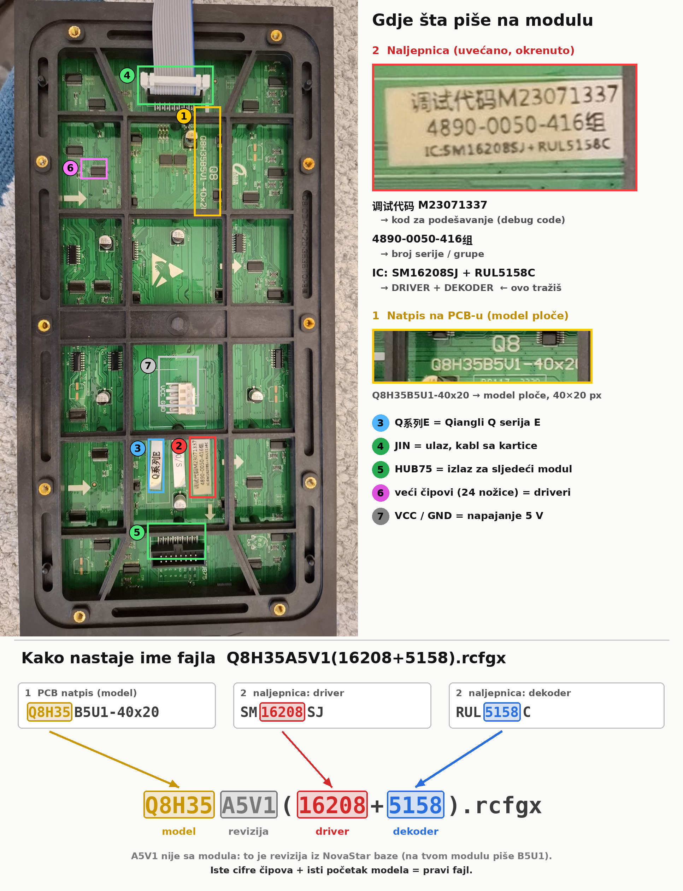

# novastar-module-config

Claude skill za pokretanje LED modula na NovaStar receiving kartici. Pomaže da se nađe i izabere tačan konfiguracioni fajl (.rcfgx / .rcfg).

Korisnik slika poleđinu modula. Claude mu kaže šta piše i gdje, napravi označenu sliku i da obrazac imena fajla za pretragu, npr. `Q8H35*(16208+5158)`. Kad korisnik slika listu fajlova iz NovaLCT-a (Load from... ili baza konfiguracija), Claude kaže koji fajl da učita, šta da provjeri prije Send i kada smije Save.

## Sadržaj

```
novastar-module-config/
├── SKILL.md                 # uputstvo koje Claude čita
├── README.md
├── scripts/
│   ├── inspect_rcfgx.py     # pregled i poređenje .rcfgx / .oscfg fajlova
│   └── annotate_module.py   # označena slika modula + obrazac imena fajla
└── tutorijal/
    ├── README.md            # kako pročitati modul i naći pravi fajl
    ├── modul_oznake_Q8.png  # primjer: označena poleđina modula
    └── primjer_oznake_Q8.json  # opis oznaka iz kojeg je slika nacrtana
```

## Tutorijal

Kako pročitati modul i kako nastaje ime fajla, na primjeru sa slikom: [tutorijal/README.md](tutorijal/README.md).



## Instalacija

**Claude Code:** kopiraj folder `novastar-module-config` u `~/.claude/skills/` (za sve projekte) ili u `.claude/skills/` unutar projekta.

**Claude aplikacija (claude.ai / desktop):** zapakuj folder u ZIP, tako da je folder `novastar-module-config` na vrhu arhive. Zatim ga dodaj kao skill u podešavanjima, u dijelu za Skills. Mora biti uključeno izvršavanje koda.

## Upotreba

U razgovoru napiši na primjer „treba mi fajl za novi LED modul“ i priloži slike naljepnice i čipova. Kad otvoriš listu konfiguracija u NovaLCT-u, slikaj je i pošalji.

Skripte rade i samostalno (Python 3.8+; `annotate_module.py` treba Pillow: `pip install pillow`):

```
python scripts/inspect_rcfgx.py novi.rcfgx zateceni.rcfgx
python scripts/annotate_module.py foto.jpg --grid mreza.png
python scripts/annotate_module.py foto.jpg oznake.json oznake.png
```

Ispisuje čip (interni kod i ime gdje je poznato), dekoder, veličinu modula i kabineta, scan i data grupe. Označava razlike i upozorava na preimenovan fajl i na kabinet veći od modula.

## Doprinos

Kad potvrdiš novi par „oznaka na modulu → ime u NovaLCT-u / ChipCode“, dopuni tabelu u `SKILL.md` i rječnik `KNOWN_CHIPCODES` u skripti. Upisuj samo parove provjerene na stvarnom modulu.

Fabričke .rcfgx fajlove ne stavljaj u repozitorij. Oni pripadaju proizvođaču i NovaStaru.
