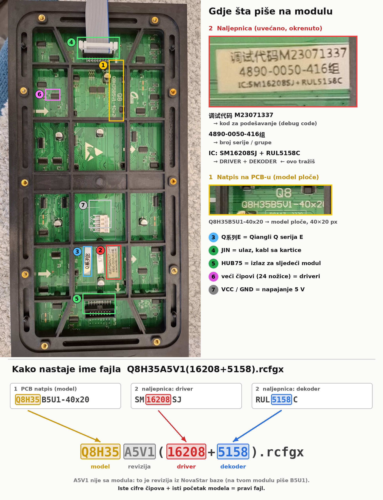

# Tutorijal: kako pročitati LED modul i naći pravi fajl

Primjer: Qiangli Q8 P8 spoljašnji modul, 40×20, na NovaStar MRV208-N.



## Šta čitaš sa modula

| Broj na slici | Šta je | Na ovom modulu |
|---|---|---|
| 1 | Model ploče, odštampan na PCB-u | Q8H35B5U1-40x20 |
| 2 | Naljepnica: kod za podešavanje (调试代码) | M23071337 |
| 2 | Naljepnica, treći red: **IC: driver + dekoder** | SM16208SJ + RUL5158C |
| 3 | Serija | Q系列E (Qiangli Q serija E) |
| 4 | Ulaz (JIN), ovdje ide kabl sa kartice | – |
| 5 | Izlaz (HUB75) za sljedeći modul | – |
| 6 | Veći čipovi = driveri | – |
| 7 | Napajanje 5 V (VCC / GND) | – |

## Kako nastaje ime fajla

Fajlovi u NovaStar bazi se zovu `Model(driver+dekoder).rcfgx`:

```
Q8H35  A5V1  ( 16208 + 5158 ) .rcfgx
  │      │      │       └── dekoder: RUL5158C sa naljepnice
  │      │      └────────── driver:  SM16208SJ sa naljepnice
  │      └───────────────── revizija iz baze (na modulu piše B5U1, nije sa modula)
  └──────────────────────── početak modela sa PCB-a
```

**Pravilo:** iste cifre čipova i isti početak modela znače pravi fajl. Ako u listi ima više fajlova za isti driver, presuđuje dekoder.

Natpis na samom čipu ima prednost nad naljepnicom. Ako sumnjaš u naljepnicu, slikaj čip izbliza (makro).
